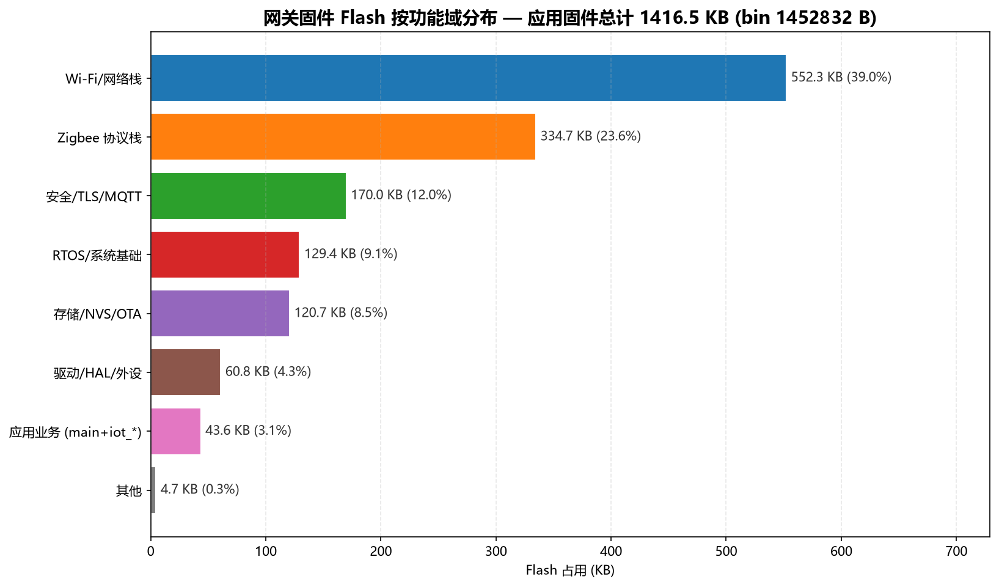
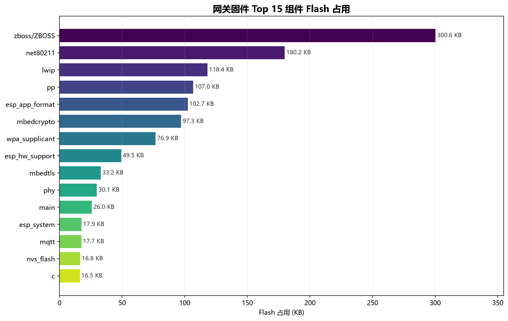
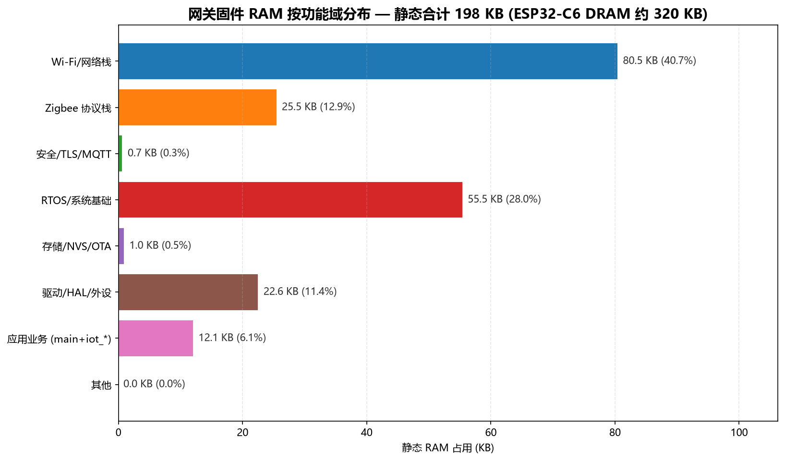
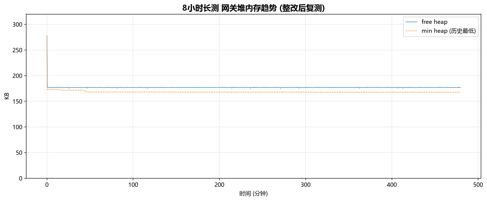
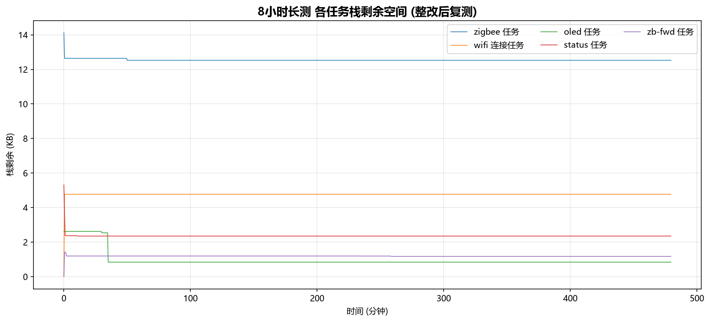

# IoT-Home 网关代码梳理与资源占用分析报告

> 分析日期：2026-10-18
> 固件版本：基于 `a60f9ea`（2026-09-28 构建）
> 目标芯片：ESP32-C6（4MB Flash，512KB SRAM）
> 数据来源：`build/iot-home-gateway.map`、`compile_commands.json`、整改后 8 小时长测日志

---

## 一、网关代码梳理

### 1.1 main.c 模块结构（共 5332 行）

| 模块 | 行数范围 | 行数 | 占比 | 职责 |
|---|---:|---:|---:|---|
| Configuration | 72–134 | 63 | 1.2% | Wi-Fi/MQTT/重启策略宏定义 |
| Globals | 135–432 | 298 | 5.6% | 全局状态、队列、节点表 |
| **RF TX 功率控制** | 433–3107 | 2675 | **50.2%** | ATPC、QUERY/SET/AUTO、后台调度、失败退避、本地控制台 |
| OLED SSD1306 | 3108–3114 | 7 | 0.1% | OLED 初始化调用 |
| Zigbee | 3115–3270 | 156 | 2.9% | ZBOSS 初始化、端点创建、入网回调 |
| ZCL 数据聚合 | 3271–3483 | 213 | 4.0% | 传感器数据聚合、去重、缓存 |
| WiFi | 3484–3992 | 509 | 9.5% | STA 连接、恢复策略、RF 健康扫描 |
| MQTT | 3993–4433 | 441 | 8.3% | MQTT 客户端、消息 ID、outbox |
| Tasks | 4434–4667 | 234 | 4.4% | 资源快照、任务创建 |
| Zigbee→MQTT 转发 | 4668–5101 | 434 | 8.1% | 事件转发、状态发布 |
| Main | 5102–5332 | 231 | 4.3% | 初始化入口、启动序列 |

**结论：RF 功率控制模块占 main.c 一半代码量（50.2%），是网关最复杂的业务逻辑。**

### 1.2 实际链接的自有组件（iot_*）

map 文件实际链接了 **11 个**自有组件：

| 组件 | Flash (B) | RAM (B) | 作用 |
|---|---:|---:|---|
| libiot_ssd1306.a | 2825 | 0 | OLED 驱动 |
| libiot_zb_node_model.a | 2364 | 0 | Zigbee 节点模型 |
| libiot_wifi_connection.a | 1674 | 55 | Wi-Fi 连接状态机 |
| libiot_product_config.a | 1486 | 0 | 产品配置 NVS |
| libiot_wifi_sta.a | 1430 | 10 | Wi-Fi STA |
| libiot_mqtt_client.a | 958 | 0 | MQTT 客户端封装 |
| libiot_rf_power_policy.a | 630 | 0 | RF 功率策略 |
| libiot_rf_packet.a | 460 | 0 | RF 报文封装 |
| libiot_rf_transaction.a | 304 | 0 | RF 事务 |
| libiot_wifi_recovery_policy.a | 260 | 0 | Wi-Fi 恢复策略 |
| libiot_provisioning_wifi_owner.a | 86 | 0 | 配网 Wi-Fi owner 状态 |

**注意：** CMakeLists 声明了 `iot_provisioning_http`、`iot_provisioning_worker`、`iot_provisioning_session`、`iot_provisioning_command`、`iot_provisioning_wifi_event`、`iot_provisioning_wifi_phase`、`iot_provisioning_recovery_quiesce` 等组件，但它们**没有符号引用、未被链接**，SoftAP/HTTP 配网尚未真正接入。

### 1.3 条件编译状态

- `RF_COMMAND_QUEUE_ENABLED`：**未定义** → RF 命令队列相关代码未编译（`libmain.a` 仅 26KB）。
- `ZB_ONLY_RF_DIAG`：定义为 0 → 正式业务模式。

---

## 二、资源占用分析

### 2.1 Flash 占用（应用固件）

应用分区 `factory` = 1,507,328 B（1472 KB）。
**bin 实际大小 = 1,452,832 B（约 1418.8 KB），剩余 54,496 B（约 53.2 KB，占分区 3.6%）。**

| 功能域 | Flash (KB) | 占比 | 说明 |
|---|---:|---:|---|
| Wi-Fi/网络栈 | 552.3 | 39.0% | net80211/lwip/wpa/pp/phy/TCP-IP |
| Zigbee 协议栈 | 334.7 | 23.6% | ZBOSS + esp_zb_api + IEEE802154 PHY |
| 安全/TLS/MQTT | 170.0 | 12.0% | mbedTLS + MQTT + TLS 传输 |
| RTOS/系统基础 | 129.4 | 9.1% | FreeRTOS/newlib/libc/heap/系统 |
| 存储/NVS/OTA | 120.7 | 8.5% | NVS + OTA + app format |
| 驱动/HAL/外设 | 60.8 | 4.3% | 驱动/HAL/GPIO/USB/SPI flash |
| 应用业务 (main+iot_*) | 43.6 | 3.1% | 网关主逻辑 + 自有 IoT 组件 |
| 其他 | 4.7 | 0.3% | 未归类组件 |
| **合计** | **1416.2** | 100% | |

**Top 5 组件：**
1. `libzboss_stack.zczr.a`（Zigbee ZBOSS 协议栈）：300.6 KB
2. `libnet80211.a`（Wi-Fi MAC/PHY）：180.2 KB
3. `liblwip.a`（TCP/IP 栈）：118.4 KB
4. `libpp.a`（Wi-Fi 协议处理）：107.0 KB
5. `libesp_app_format.a`：102.7 KB（含 104KB rodata 大表）

### 2.2 RAM 占用

ESP32-C6 内置 **512KB SRAM**，其中 DRAM 可寻址约 320KB。

| 功能域 | 静态 RAM (KB) | 占比 | 说明 |
|---|---:|---:|---|
| Wi-Fi/网络栈 | 80.5 | 40.7% | lwip 缓冲、net80211、pp |
| RTOS/系统基础 | 55.5 | 28.0% | FreeRTOS、堆、系统 |
| Zigbee 协议栈 | 25.5 | 12.9% | ZBOSS、IEEE802154 |
| 驱动/HAL/外设 | 22.6 | 11.4% | 驱动、SPI flash 缓存 |
| 应用业务 | 12.1 | 6.1% | main + iot_* |
| 存储/NVS/OTA | 1.0 | 0.5% | |
| 安全/TLS/MQTT | 0.7 | 0.3% | |
| **合计** | **197.8** | 100% | |

**运行时实测（8小时长测）：**

| 指标 | 数值 |
|---|---:|
| 静态 RAM 占用 | ~198 KB |
| 运行时 free heap 最低 | 179,508 B（175.3 KB） |
| 运行时 free heap 最终 | 180,988 B（176.7 KB） |
| min heap 最低 | 171,796 B（167.8 KB） |
| 内存泄漏 | 无（8小时稳定） |

**任务栈水位（剩余空间）：**

| 任务 | 配置栈 | 最低剩余 | 峰值使用 | 健康度 |
|---|---:|---:|---:|---|
| zigbee | 16384 B | 12,828 B | ~3.5 KB | 充裕 |
| wifi 连接 | 5120 B | 0 B* | ~5 KB | ⚠️ 需关注 |
| oled | 4096 B | 860 B | ~3.2 KB | ⚠️ 偏紧 |
| status | 6144 B | 2,408 B | ~3.7 KB | 正常 |
| zb-fwd | 5120 B | 0 B* | ~5 KB | ⚠️ 需关注 |

> *`wifi=0` 和 `fwd=0` 出现在启动初期（任务可能尚未创建或采样时任务未运行）。需要区分是采样时机还是真实耗尽。从 8 小时稳定运行看，大概率是启动初期采样时机问题，但建议后续用 `uxTaskGetStackHighWaterMark` 在任务稳定后单独采样确认。

---

## 三、网关还能做什么功能？

### 3.1 当前已实现

- Zigbee 3.0 Coordinator（ZBOSS）
- Wi-Fi STA + MQTT 桥接
- 传感器遥测上行（温湿度、光照）
- on/off/toggle 远程控制
- RF 功率自动控制（ATPC）
- OLED 状态显示
- NVS 产品配置（A/B bundle 已就绪）

### 3.2 剩余资源能支撑的功能

**Flash 仅剩 ~53 KB（3.6%），RAM 可用 ~175 KB。**

| 功能 | Flash 预估 | RAM 预估 | 可行性 | 说明 |
|---|---:|---:|---:|---|
| SoftAP/HTTP 配网 | 20–40 KB | 10–20 KB | ⚠️ 紧张 | 需先精简；`iot_provisioning_*` 组件已就绪但未链接 |
| Web 状态页（小型） | 15–30 KB | 5–10 KB | ⚠️ 紧张 | 需 httpd + 页面资源 |
| OTA 升级 | 已含 app_update | ~0 | ✅ 已就绪 | 只差触发逻辑和服务器 |
| 更多节点（>10） | 少量 | 每节点 ~200B | ✅ 可行 | 目前 MAX_ZB_NODES=10 |
| 本地规则引擎 | 8–15 KB | 2–5 KB | ⚠️ 紧张 | 需精简 |
| 电池节点支持 | 少量 | 少量 | ✅ 可行 | 协议层已支持 |
| 加密 MQTT（TLS） | 0（TLS 已链接） | ~40–50 KB | ⚠️ 需评估 | mbedTLS 已就绪但运行时握手需额外堆 |
| 蓝牙配网 | 大 | 大 | ❌ 不建议 | 需额外 BLE 协议栈 |

### 3.3 关键判断

1. **SoftAP/HTTP 配网是目前设计中最“近”但最“挤”的功能**：组件已写好但未链接，一旦接入预计增加 20–40KB Flash。剩余 53KB 理论够，但加上页面资源和日志，风险高。
2. **TLS 加密 MQTT**：TLS 库已链接（mbedTLS 170KB），但运行时 TLS 握手需要额外 40–50KB 堆，当前 free heap 175KB 可以承受，但会压缩其他动态分配空间。
3. **当前瓶颈是 Flash，不是 RAM**：RAM 还有 175KB 余量，但 Flash 只剩 53KB。

---

## 四、是否需要扩容？

### 4.1 当前资源结论

| 资源 | 容量 | 已用 | 剩余 | 状态 |
|---|---:|---:|---:|---|
| Flash（应用分区） | 1472 KB | 1418.8 KB | **53.2 KB (3.6%)** | 🟠 偏紧 |
| SRAM（DRAM） | ~320 KB | ~198 KB 静态 | ~175 KB 运行时 | 🟢 充足 |
| 任务栈 | 各任务 | — | zigbee/status 充裕，oled/wifi/fwd 偏紧 | 🟡 关注 |

### 4.2 扩容方案对比

| 方案 | 成本 | 效果 | 推荐 |
|---|---|---:|---|
| **保持现状** | 0 | 当前功能可运行，但无法加 SoftAP/OTA 页面 | 短期 |
| **压缩/精简固件** | 低 | 可释放 20–80KB：去掉 `libesp_app_format` rodata、裁剪日志、裁剪 lwip、裁剪未用驱动 | ⭐ 首选 |
| **扩大应用分区** | 低 | 从 zb_storage/phy/nvs 挤空间；但需重刷分区表（当前禁止） | 需授权 |
| **换更大 Flash 芯片** | 中 | 如 ESP32-C6 4MB→8MB 需硬件改动 | 长期 |
| **换 ESP32-C6 加 PSRAM 版本** | 中高 | 解决 RAM，但 Flash 仍可能不足 | 不必要 |

### 4.3 建议

1. **短期不扩容**：当前功能运行稳定，RAM 充足；若近期不增加 SoftAP/配网，无需扩容。
2. **若要加 SoftAP/HTTP 配网**：优先精简固件释放 Flash，而不是换硬件。可裁剪项：
   - `libesp_app_format.a` 的 104KB rodata（检查是否必需）；
   - 日志级别从 INFO 降到 WARN（可省部分 Flash 和运行时开销）；
   - 裁剪未用驱动组件；
   - 移除 `libbtbb.a`（4.3KB，若无 BT 需求）。
3. **扩容优先级**：Flash 是瓶颈 → 若确实需要大功能，首选**扩大 factory 分区**（需重新规划分区表并授权刷写）或**换 8MB Flash 芯片**。
4. **任务栈**：建议把 `oled` 任务栈从 4096 增至 5120，`wifi`/`fwd` 任务增加监控采样，确认 0 值是否为采样时机问题。

---

## 五、结论

- **网关代码核心是 RF 功率控制（50% 代码量）+ 协议桥接**，自有业务代码仅占 Flash 3.1%。
- **资源瓶颈是 Flash（剩 53KB），RAM 充足（剩 175KB）**。
- **当前无需扩容**；若要新增 SoftAP/HTTP 配网等大功能，应先精简固件释放 Flash，必要时再扩大分区或换大 Flash 芯片。
- 任务栈 oled/wifi/fwd 需补充观测确认，但 8 小时长测无异常，风险可控。
